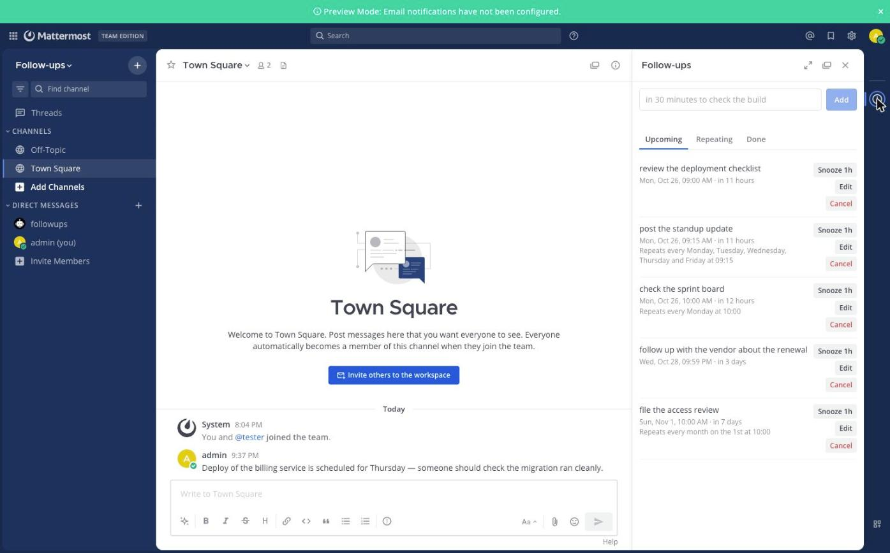
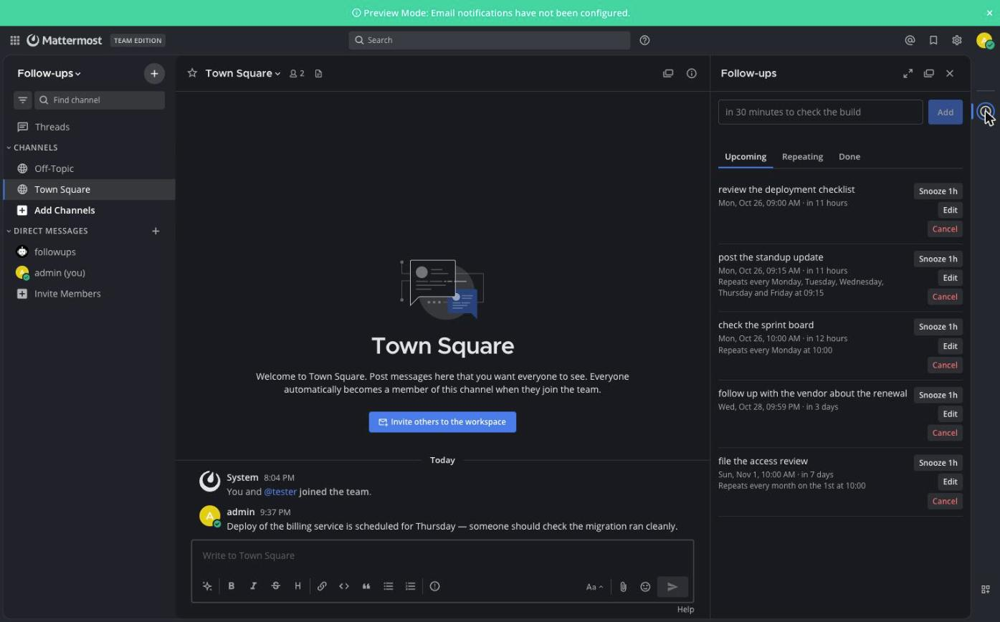
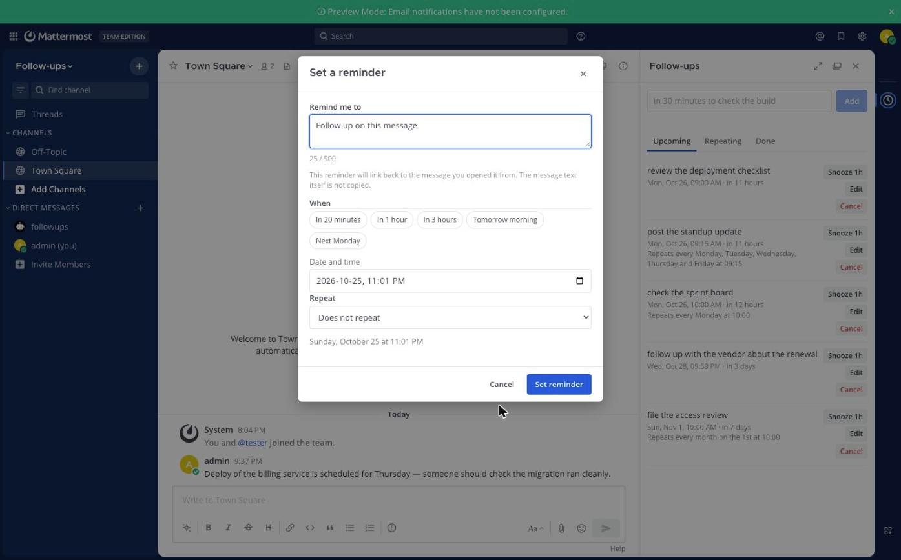
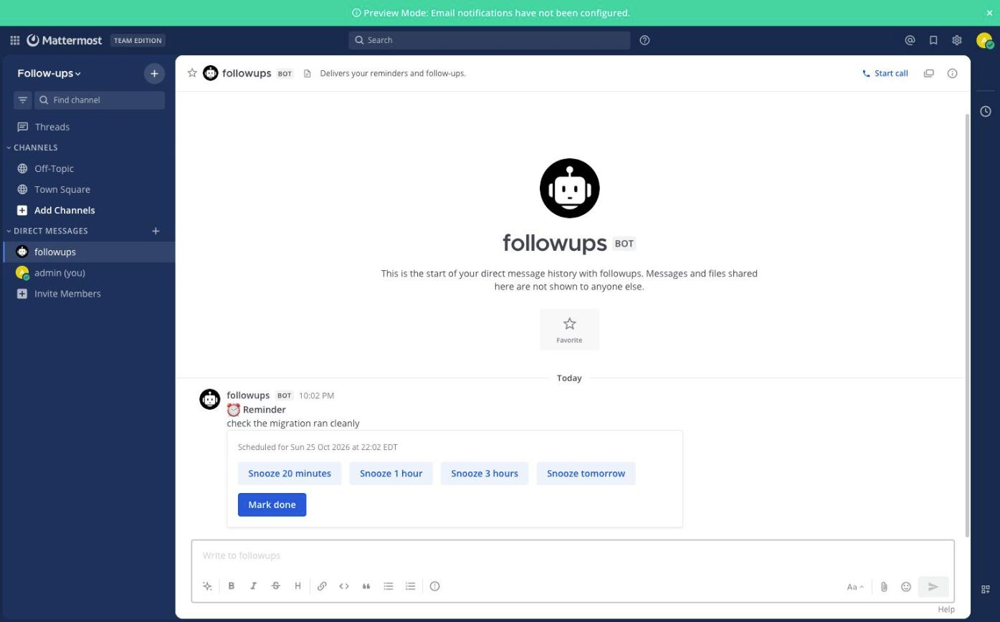

# Mattermost Follow-ups & Reminders

Create one-time and recurring reminders in Mattermost, from a slash command or
from any message, and manage them in a sidebar that looks like the rest of the
product. Everything runs inside your own server: no external service, no API
key, no extra database.

[](LICENSE)

## Why this exists

Mattermost already does two related things well. Since v7.10 you can set a
**one-off reminder on a message**, and since v10.3 you can **schedule a message**
to send later. Neither covers a standing reminder, and neither lets you write
one in your own words.

This plugin fills that gap:

| | Native message reminders | Native scheduled messages | This plugin |
|:--|:--|:--|:--|
| Reminder with your own text | no | n/a | yes |
| Set from a slash command | no | no | yes |
| Recurring reminders | no | no | yes |
| Manage, edit and snooze a list | no | partial | yes |
| Linked back to a message | yes | no | yes |

The older community `/remind` plugin covered some of this, but it was
[archived in November 2023](https://github.com/scottleedavis/mattermost-plugin-remind)
and was never in the Marketplace. This is a fresh implementation against the
current plugin API.

## Screenshots

**Your reminders, in a sidebar that follows the Mattermost theme**

| Default theme | Dark theme |
|:--|:--|
|  |  |

**Set one from any message** — in the **Actions** menu, not the `…` menu:


**Pick a time, or let it repeat:**



**It arrives as a direct message, with snooze and done built in:**



## Features

- **`/remind` with plain-English times.** `in 30 minutes`, `tomorrow at 9am`,
  `Friday at 2pm`, `2026-11-03 at 14:30`, `every weekday at 9:15`. The grammar
  is deterministic and documented below — no AI service is involved.
- **Remind me about this message.** From any message's **Actions** menu. The
  reminder keeps a link to the message, and only the link: the message text is
  never copied into the plugin's storage.
- **Recurring reminders.** Daily, weekly, on chosen weekdays, monthly, or on a
  fixed interval. Daylight-saving transitions, short months and missed runs are
  all handled explicitly.
- **Delivered as a direct message**, so reminders follow your existing
  notification settings and reach the mobile apps through the usual push path.
- **Snooze and dismiss buttons** on every delivered reminder.
- **A sidebar** to see what is upcoming, what repeats and what is done, and to
  add, edit, snooze or cancel without leaving the channel.
- **Survives restarts.** Scheduling is persisted, not held in memory, and a
  server that comes back after an outage delivers what it missed.
- **Private by construction.** Every read and write is scoped to the user who
  made the request. There is no code path that reads one person's reminders on
  behalf of another.

## Requirements

- Mattermost Server **v9.5.0 or later**
- No database, container or external service beyond Mattermost itself

> The integration suite passes end-to-end against both v9.5 and v12.0.1 Team
> Edition, so the minimum is measured rather than inferred. The releases in
> between have not been run; see
> [Compatibility and limitations](#compatibility-and-limitations).

## Installation

**From a release bundle**

1. Download `com.github.leightonrodney.followups-<version>.tar.gz` from the
   [releases page](https://github.com/leightonrodney/mattermost-plugin-followups/releases).
2. Verify it against the published `checksums.txt`:
   ```bash
   sha256sum --check checksums.txt
   ```
3. In Mattermost, go to **System Console → Plugins → Plugin Management** and
   upload the bundle.
4. Enable the plugin.

**From source**

```bash
git clone https://github.com/leightonrodney/mattermost-plugin-followups.git
cd mattermost-plugin-followups
make dist
```

The bundle is written to `dist/`. See [docs/DEVELOPMENT.md](docs/DEVELOPMENT.md)
to deploy straight to a development server.

## Usage

### Setting a reminder

```
/remind me in 30 minutes to check the build
/remind me tomorrow at 9am to review the deployment
/remind me every Monday at 10am to check the sprint board
/remind me to call the vendor back on Friday at 2pm
```

The subject (`me`) is optional, and the text may come before or after the time.
When both would work, a time at the end wins — unless the text is introduced by
`to`, in which case the time at the front wins. That makes both natural
orderings mean what they look like.

### When

| Form | Examples |
|:--|:--|
| Relative | `in 30 minutes`, `in 2 hours`, `in 3 days`, `in 2 weeks`, `in an hour`, `in half an hour`, `in 1 month` |
| Short units | `in 30m`, `in 2h`, `in 3d`, `in 1w` |
| Named days | `today at 6pm`, `tonight`, `tomorrow`, `tomorrow at 9am` |
| Weekdays | `Monday`, `Friday at 10am`, `next Tuesday at 10:00` |
| Ahead | `next week`, `next month` |
| Dates | `2026-11-03 at 14:30`, `Nov 3`, `Nov 3rd at 2pm`, `3 November`, `Jan 5 2027` |
| Clock only | `at 9am`, `at 18:00`, `at noon`, `at midnight` |

A time with no date means the next time that clock time comes round. A date with
no time means 09:00. Everything is read in **your** Mattermost timezone.

Numeric slash dates such as `11/03` are refused rather than guessed at, because
they mean different days on different sides of the Atlantic. Write `2026-11-03`
or `Nov 3`.

### Repeating

```
/remind me every day at 9am to stand up
/remind me every weekday at 9:15 to post the update
/remind me every Monday and Friday at 10am to sync
/remind me every other Monday at 10am to sync
/remind me every 3 days at 8am to water the plants
/remind me every month on the 15th at 9am to file the report
/remind me every 2 hours to drink water
/remind me every weekend at 11am to call home
```

Weekday lists accept `and` or commas: `every mon,wed,fri at 10am`.

Two kinds of repetition are deliberately kept apart:

- **Wall-clock rules** (`every day`, `every weekday`, `every month`) pin an hour
  and minute in your timezone. "Every weekday at 9am" stays at 9am through a
  daylight-saving change, even though the real gap that day is 23 or 25 hours.
- **Interval rules** (`every 2 hours`, `every 30 minutes`) count elapsed time, so
  a daylight-saving change moves the wall clock instead.

### Managing reminders

```
/remind list
/remind snooze <id> 20 minutes
/remind cancel <id>
/remind delete <id>
/remind help
```

`<id>` is the short code shown by `/remind list`. Any unambiguous prefix works.

Or open the sidebar: click the clock icon in the channel header. It has tabs for
**Upcoming**, **Repeating** and **Done**, a box at the top that takes the same
phrases as the slash command, and edit, snooze and cancel on every row.

### From a message

Hover a message, open the **Actions** menu (the icon next to **…**) and choose
**Remind me**. Pick a preset or a specific time. The reminder links back to the
message, and when it arrives the link is only included if you can still read
that channel.

> Not the **…** menu. Mattermost puts plugin items in **Actions**, and the
> **Remind** entry you will find under **…** is Mattermost's own one-off
> reminder, not this plugin.

### When a reminder arrives

It comes as a direct message from the **Follow-ups** bot, with the scheduled
time, a link to the original message where there is one, and buttons to snooze
by 20 minutes, an hour, three hours or until tomorrow morning.

Snoozing a *repeating* reminder creates a one-off copy and leaves the series
alone, so postponing one occurrence does not drag the whole schedule with it.

## Configuration

**System Console → Plugins → Follow-ups & Reminders**

| Setting | Default | What it does |
|:--|:--|:--|
| Enable reminder delivery | on | Turning it off stops delivery. Reminders can still be created and are delivered late once it is back on. |
| Scheduler interval (seconds) | 30 | How often the scheduler looks for due reminders. Clamped to 10–900. |
| Maximum active reminders per user | 100 | Clamped to 1–10000. |
| Maximum recurring reminders per user | 20 | Clamped to 0–1000. Setting it to 0 turns repeating reminders off. |
| Minimum scheduling interval (seconds) | 60 | The soonest a reminder may be set, and the shortest gap between occurrences. Clamped to 30–86400. |
| Maximum reminder horizon (days) | 730 | How far ahead a reminder may be set. Clamped to 1–3650. |
| Completed reminder retention (days) | 30 | How long finished reminders are kept. Clamped to 0–365. |
| Enable debug logging | off | Logs scheduler and API activity. Reminder text is never logged at any level. |

Every setting takes effect immediately, except **Scheduler interval**, which
applies from the next scheduler tick. Out-of-range values are clamped rather
than rejected, so a typo slows the scheduler down instead of stopping the
plugin.

## Privacy and security

- Every plugin API request requires an authenticated Mattermost user; there is
  no unauthenticated endpoint.
- Reminders are stored under a key derived from the owner's user ID, and every
  operation is scoped to the requesting user. A reminder ID belonging to someone
  else behaves exactly like one that does not exist, so IDs cannot be probed.
- Creating a reminder from a message checks that you can read that channel, and
  the check is repeated when the reminder is delivered — so losing access to a
  private channel also stops the permalink appearing.
- Message text is never copied into the plugin's storage. Only the channel and
  post IDs are kept, and the permalink is rebuilt per request.
- Reminder text and message contents are never written to the server log, at any
  log level.
- Interactive buttons act as the user the server authenticated, never as the
  user named in the button's payload.

See [SECURITY.md](SECURITY.md) to report a vulnerability.

## Compatibility and limitations

- **Delivery is at-least-once, not exactly-once.** A worker that dies after
  posting a reminder but before recording it will deliver that occurrence again
  after a five-minute claim timeout. The window is small and the cost is a
  duplicate message. [docs/ARCHITECTURE.md](docs/ARCHITECTURE.md) explains why
  exactly-once is not achievable over the plugin key-value store.
- **Missed occurrences are skipped, not replayed.** A daily reminder that was
  missed for a fortnight fires once when the server returns, not fourteen times.
- **A plugin disabled for more than 90 days** loses the index entries for that
  window. Those reminders stay visible as overdue and can be rescheduled, but
  they are not delivered automatically.
- **Reminder delivery depends on the Follow-ups bot account.** If an
  administrator deactivates it, reminders stop arriving.
- **Not verified on a real multi-node cluster.** The integration suite installs
  the plugin into a real server and checks that a reminder is genuinely
  delivered, at both ends of the supported range — 9.5 and 12.0.1 — but against
  a single node. The coordination a cluster relies on is tested by sharing a
  key-value store between plugin instances, which exercises the mechanism but is
  not a licensed HA deployment. See [docs/TESTING.md](docs/TESTING.md).
- **Push notifications are not verified end to end.** Reminders are ordinary
  direct messages and are tested to be the kind of post the server will notify
  about, but no test watches one arrive on a device.

## Contributing

See [CONTRIBUTING.md](CONTRIBUTING.md). Issues and pull requests are welcome.

## Documentation

- [docs/ARCHITECTURE.md](docs/ARCHITECTURE.md) — storage, scheduling, delivery guarantees
- [docs/DEVELOPMENT.md](docs/DEVELOPMENT.md) — local setup and debugging
- [docs/TESTING.md](docs/TESTING.md) — what is tested and how to run it
- [docs/RESEARCH.md](docs/RESEARCH.md) — the API research this was built on
- [docs/RELEASE.md](docs/RELEASE.md) — packaging, releasing, Marketplace submission
- [docs/ROADMAP.md](docs/ROADMAP.md) — what is recommended next, and what was left out on purpose

## License

[MIT](LICENSE).
